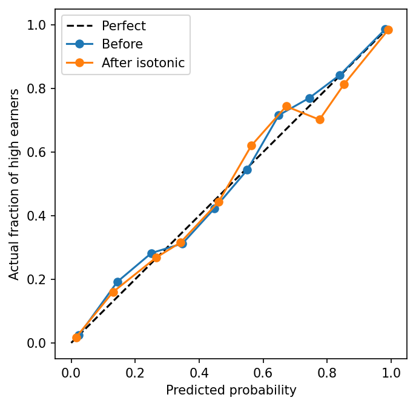
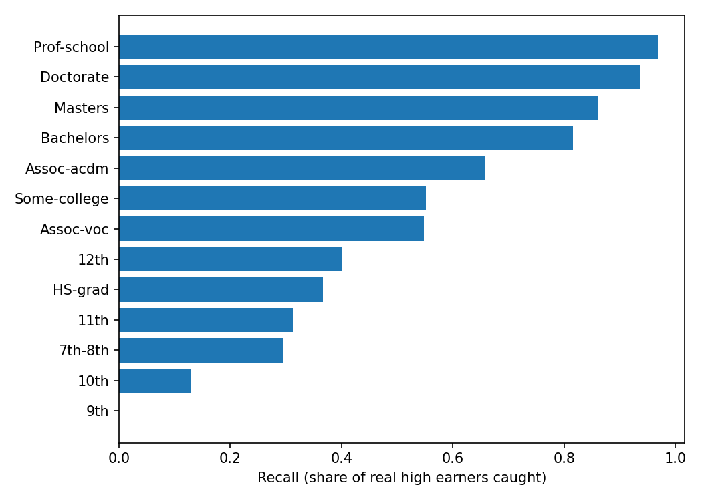

# Does the Model Know When It's Wrong?.

A machine learning project on calibration and error analysis using the UCI Adult Income dataset.

Gradient Boosting reached 0.876 accuracy and 0.928 AUC on the test set.

## What I wanted to find out

For this project, I wanted to see how well a machine learning model could predict whether a person earns more than $50K per year. I also wanted to check whether the probabilities predicted by the model were reliable and where it made the most mistakes.

I used two models, Logistic Regression and Gradient Boosting, and compared their performance.

One thing I found interesting was that Gradient Boosting gave better results overall, but it still struggled to identify high earners in some groups, especially people with lower levels of formal education.

Another thing I noticed was that the model was already reasonably well calibrated. Applying isotonic regression didn't improve the calibration score, so I decided to keep the original probabilities.

## Dataset and setup

- **Dataset:** UCI Adult Income dataset
- **Data:** 48,842 rows with 14 input features
- **Goal:** Predict whether a person's income is above $50K per year
- **Class distribution:** Around 24% of the records belong to the above-$50K category
- **Train/validation/test split:** 60% / 20% / 20%
- **Random seed:** 42

I used median and most-frequent imputation for missing values, scaling for numerical features, and one-hot encoding for categorical features. Preprocessing was fitted on the training data only.

I used the validation set to fit the isotonic calibrator and kept the test set for the final evaluation. I didn't use the test results to choose or tune the models.

## Model performance

Here are the results on the test set.

| Model | Accuracy | F1 score | AUC |
|---|---:|---:|---:|
| Logistic Regression | 0.855 | 0.662 | 0.907 |
| Gradient Boosting | 0.876 | 0.716 | 0.928 |

Gradient Boosting performed better on all three metrics, although the improvement wasn't huge. Logistic Regression also gave reasonably good results, which was interesting because it's a simpler model.

Accuracy alone doesn't tell the whole story here. Around 76% of the dataset belongs to the below-$50K category, so a model can get a decent accuracy score without identifying enough high earners. That's why I also looked at F1 and AUC.

## Checking calibration

I wanted to check whether the predicted probabilities were close to what actually happened. For example, if a model predicts a probability of 80% for a group of people, we would expect roughly 80% of them to belong to the positive class, on average.

I used Expected Calibration Error (ECE) to compare the probabilities before and after isotonic regression.

| Model | ECE (lower is better) |
|---|---:|
| Gradient Boosting (raw probabilities) | 0.0136 |
| After isotonic regression | 0.0148 |

The raw probabilities had a lower ECE than the calibrated probabilities. The difference was small, but isotonic regression didn't improve the result, so I kept the original probabilities.

This was one of the more interesting parts of the project because calibration didn't automatically improve just because I applied a calibration method.

## Where the model struggled

Even though the overall results looked good, the model didn't perform equally well across all groups. I looked at recall to understand how many actual high earners the model correctly identified.

### Education

The model caught only 36.7% of actual high earners among high school graduates, compared with 81.6% among those with a bachelor’s degree.

This means the model identified a much smaller proportion of high earners in the high school graduate group. It seems that the model relies heavily on patterns associated with education, although these results alone don't tell us exactly why the difference occurs.

### Sex

The model's accuracy was 0.939 for women and 0.844 for men. However, recall was lower for women: 0.592 compared with 0.665 for men.

This difference is important because accuracy can be misleading when groups have different proportions of positive cases. In this dataset, around 11.4% of women and 30.3% of men belonged to the above-$50K category.

### Age

Recall was 0.310 for people aged 17–25 and 0.741 for those aged 46–55.

The model identified fewer high earners in the younger age group. Since the dataset contains relatively few young people earning above $50K, this result should also be considered in the context of the number of positive cases available.

### Small groups

Some education categories had very few positive cases. For example, the 9th-grade group had 154 records but only around five high earners.

Results for groups this small can change considerably with just a few predictions, so I wouldn't draw strong conclusions from them.

## What I learned

A few things stood out to me during this project:

- Gradient Boosting performed better than Logistic Regression, but the difference wasn't as large as I might have expected.
- The raw probabilities were already reasonably well calibrated, and isotonic regression didn't improve the ECE.
- A model can have good overall accuracy while still missing many positive cases in certain groups.
- Looking at recall gave me a different perspective on the model's performance than looking at accuracy alone.

The main takeaway for me was that evaluating a model involves more than checking whether its predictions are correct. It's also important to understand how reliable its probabilities are and where it tends to make mistakes.

## Model card

- **Purpose:** Learning and portfolio project.
- **Dataset:** UCI Adult Income dataset, based on historical US census data from 1994.
- **Intended use:** Educational analysis only, not real-world decisions about individuals.
- **Known limitations:** The model misses many high earners in some education groups. The dataset includes sex as an input feature, and results for small groups are less reliable.
- **Decision threshold:** 0.5.
- **Important note:** The findings describe the model's behaviour on this dataset. They don't establish the causes of the observed differences, and the historical patterns may not reflect present-day incomes.

## How to run the project

1. Open `calibration_analysis.ipynb` in Google Colab.
2. Select **Runtime → Run all**.
3. Wait for the cells, metrics, and plots to finish running.

## Tools used

- Python
- pandas
- scikit-learn
- matplotlib

## Author

Sumaanya Turaka
